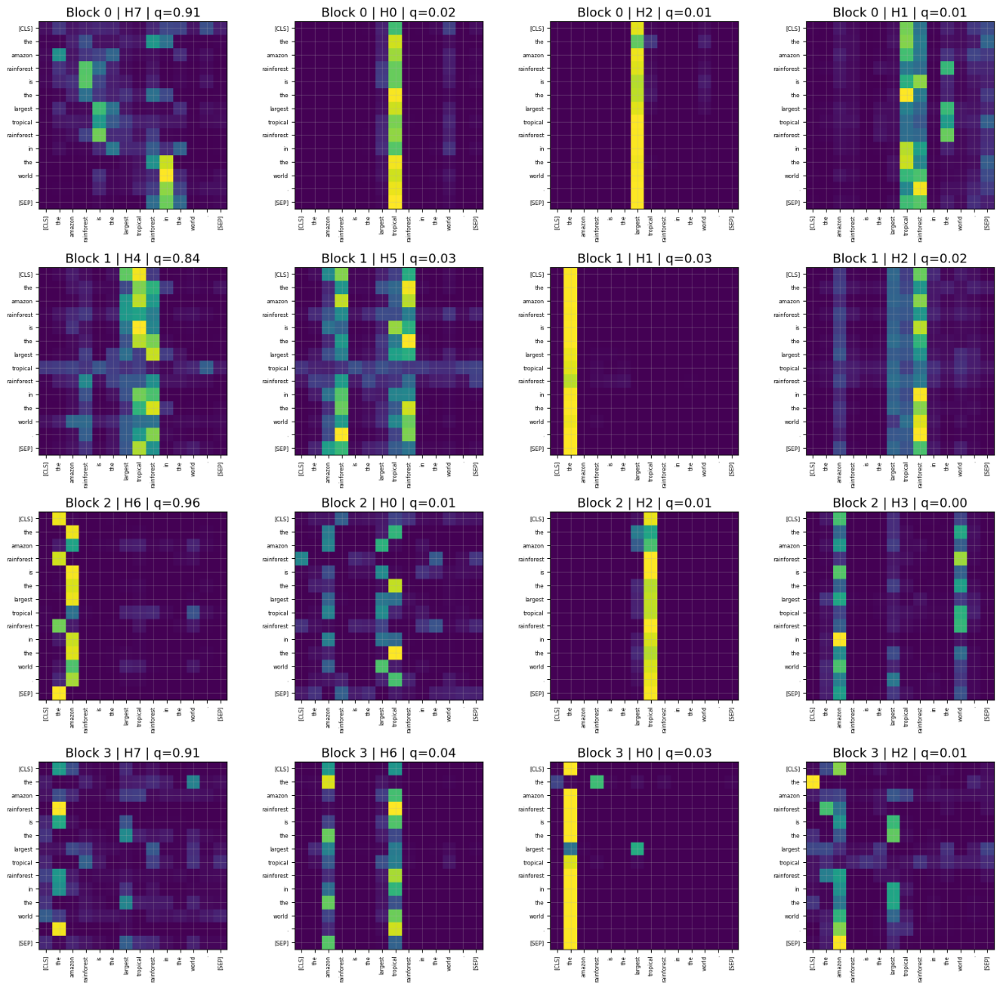

# BudgetFormer: Adaptive Head Budgeting for Efficient Multi-Head Attention

BudgetFormer is an adaptive framework that dynamically allocates the number of active attention heads on a per-input basis. By learning both an input-dependent head budget and a relevance distribution over heads, BudgetFormer reduces inference computational complexity (FLOPs), activation memory, and carbon footprint while matching or surpassing the predictive performance of standard dense multi-head attention.

## Key Features

- **Dynamic Head Budget Allocation**: Learns an input-dependent head budget ($s_{\text{pred}}$) and head relevance distribution ($q_{\text{head}}$), activating only the most informative heads per sample.
- **Over-Parameterization Mitigation**: Eliminates redundant attention heads dynamically, showing that optimal performance is frequently achieved with far fewer active heads than standard configurations.
- **Broad Backbone Support**: Implemented for both from-scratch encoders/decoders and standard pre-trained backbones (BERT, RoBERTa, DistilBERT, DeBERTa, Longformer).
- **Efficiency and Green AI Profiling**: Built-in estimators for theoretical inference FLOPs, activation memory, parameter memory, and carbon emissions (gCO2).
- **Exploration-Exploitation Training Strategy**: Balances exploratory gating during training (temperature and noise scheduling) with focused budget utilization.

## Quickstart

### Installation

```bash
conda create -n BudgetFormer python=3.10 pip -y
conda activate BudgetFormer
conda install pytorch torchvision torchaudio pytorch-cuda=12.1 -c pytorch -c nvidia
pip install transformers datasets scikit-learn numpy
```

### Datasets

The repository natively supports standard Hugging Face datasets:

- **DBpedia-14**: [dbpedia_14](https://huggingface.co/datasets/dbpedia_14) - Large-scale topic categorization (14 classes)
- **AG News**: [ag_news](https://huggingface.co/datasets/ag_news) - Topic classification (4 classes)
- **IMDb**: [imdb](https://huggingface.co/datasets/imdb) - Binary sentiment classification
- **SNLI**: [snli](https://huggingface.co/datasets/snli) - Natural language inference (3 classes)
- **Yelp Review Full**: [yelp_review_full](https://huggingface.co/datasets/yelp_review_full) - Fine-grained review sentiment (5 classes)

## Usage

### 1. Proof of Concept (POC) & Ablations

Train the baseline Transformer:
```bash
python "AdaTransformer/1. POC/baseline.py"
```

Train BudgetFormer with dynamic head allocation:
```bash
python "AdaTransformer/1. POC/adaT.py"
```

Run ablation studies (Fixed budgets, Random selection, Gating variants):
```bash
python "AdaTransformer/1. POC/ablation.py"
```

### 2. Pretrained Encoders

BudgetFormer is adapted across various transformer encoder backbones:

- **BERT**:
  ```bash
  python "AdaTransformer/2. Encoder/BERT/adaT.py"
  ```
- **RoBERTa**:
  ```bash
  python "AdaTransformer/2. Encoder/Roberta/adaT.py"
  ```
- **DistilBERT**:
  ```bash
  python "AdaTransformer/2. Encoder/DistilBERT/adaT.py"
  ```
- **DeBERTa**:
  ```bash
  python "AdaTransformer/2. Encoder/Deberta/adaT.py"
  ```
- **Longformer**:
  ```bash
  python "AdaTransformer/2. Encoder/LongFormer/adaT.py"
  ```

### 3. Decoder Models

Test autoregressive and decoder architectures with KV-cache support:

```bash
# In-distribution training
python "AdaTransformer/3. Deocder/adaT/scratch.py"

# Out-of-distribution (OOD) evaluation
python "AdaTransformer/3. Deocder/adaT/ood.py"

# Instruction fine-tuning
python "AdaTransformer/3. Deocder/adaT/instruct.py"
```

### 4. Task-Specific Benchmarks

Run dedicated task experiments:

```bash
cd "AdaTransformer/ada_transformer/adaT/snli"
python main.py
```

## Experimental Results

Below are the official experimental results reported in the paper (*ESANN*):

### Main Results

| Dataset | Standard Transformer Acc | BudgetFormer Acc | Transformer FLOPs ($10^{12}$) | BudgetFormer FLOPs ($10^{12}$) | Transformer CO2 (g) | BudgetFormer CO2 (g) | Mean Budget ($s_{\text{mean}}$) |
| :--- | :--- | :--- | :--- | :--- | :--- | :--- | :--- |
| **DBpedia** | 0.9830 | **0.9859** | 44.0 | **42.6** | 0.1468 | **0.1420** | 0.085 |
| **AG News** | **0.9099** | 0.9022 | 4.78 | **4.65** | 0.0159 | **0.0155** | 0.212 |
| **IMDB** | 0.8354 | **0.8356** | 161 | **145** | 0.5376 | **0.4840** | 0.601 |
| **SNLI** | 0.7835 | **0.8106** | 6.18 | **6.05** | 0.0206 | **0.0202** | 0.364 |
| **Yelp** | 0.5810 | **0.6190** | 323 | **258** | 1.0751 | **0.8591** | 0.198 |

*FLOPs are reported in units of $10^{12}$ for all datasets. $s_{\text{mean}}$ represents the average predicted fraction of attention heads allocated per input.*

### Ablation Study

Ablation evaluation comparing fixed budgets ($s \in \{0.1, 0.25, 0.5, 0.75, 1.0\}$) without the learned budget predictor and random head selection:

| Dataset | $s=0.1$ | $s=0.25$ | $s=0.5$ | $s=0.75$ | $s=1.0$ | Random Selection | Full BudgetFormer |
| :--- | :--- | :--- | :--- | :--- | :--- | :--- | :--- |
| **DBpedia** | 0.9846 | 0.9478 | 0.6202 | 0.3245 | 0.1670 | 0.7511 | **0.9859** |
| **AG News** | 0.8905 | 0.8974 | 0.8675 | 0.8139 | 0.7554 | 0.8180 | **0.9022** |
| **IMDB** | 0.7296 | 0.8036 | 0.8246 | 0.8289 | 0.8162 | 0.7493 | **0.8356** |
| **SNLI** | 0.6704 | 0.7598 | 0.5838 | 0.3541 | 0.3190 | 0.3370 | **0.8106** |
| **Yelp** | 0.5818 | 0.5813 | 0.2737 | 0.1013 | 0.0743 | 0.3244 | **0.6190** |

## Empirical Visualizations & Analysis

### 1. Predicted Budget Distributions Across Benchmarks
The distribution of predicted budgets reflects individual task complexity. Coarser-grained tasks (such as DBpedia-14) converge to small head budgets ($s_{\text{mean}} = 0.085$), whereas richer semantics (IMDb, SNLI) adaptively allocate larger budgets.

<p align="center">
  
</p>

### 2. Multi-Head Sparsity and Performance Curves
Evaluating accuracy across head budgets demonstrates that standard full-head allocation is largely over-parameterized. Peak performance is achieved with a fraction of active heads:

<p align="center">
  
</p>

### 3. Task Complexity & Semantic Ambiguity (SNLI Analysis)
On SNLI, neutral pairs (semantically ambiguous) exhibit higher mean budgets ($s_{\text{mean}}$) and greater entropy than straightforward entailment pairs, showing that BudgetFormer dynamically expands its attention capacity when facing harder inputs:

<p align="center">
  
  
  
</p>

### 4. Attention Allocation & Head Specialization Heatmaps
Sample-level visualization of attention scores and gating weights demonstrates layer-wise sparsity and head specialization:

<p align="center">
  
</p>

## Interactive Notebook

An end-to-end interactive demo containing model definition, training loops, profiling (FLOPs, memory, carbon), and attention head visualization heatmaps is available at:
- `AdaTransformer/AdaTransformer.ipynb`

## Default Training Configuration

- **Batch Size**: 16
- **Learning Rate**: 2e-5 (AdamW)
- **Optimizer**: AdamW
- **Epochs**: 10
- **Model Dimension (d_model)**: 768
- **Number of Heads**: 8 (or 12 for larger backbones)
- **Budget Interval**: s_min = 0.1, s_max = 0.9
- **Temperature Schedule**: Tau annealed from 2.0 to 0.1
- **Loss Formulation**: Task cross-entropy + adaptive budget penalty loss

## Citation

If you find BudgetFormer useful in your research, please cite:

```bibtex
@inproceedings{mbaye2026budgetformer,
  title={BudgetFormer: Adaptive Head Budgeting for Efficient Multi-Head Attention},
  author={Mbaye, Abdoulaye and Faye, Bilal and Azzag, Hanane and Lebbah, Mustapha},
  booktitle={European Symposium on Artificial Neural Networks, Computational Intelligence and Machine Learning (ESANN)},
  year={2026}
}
```
